# AnimeCaos

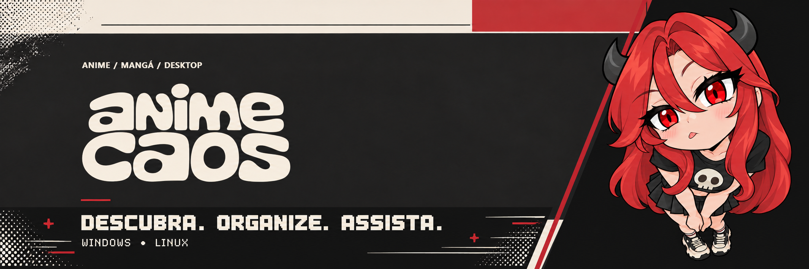

<p align="center">
  <a href="https://github.com/henriqqw/AnimeCaos/releases/tag/v3.0.0">⬇️ Baixar v3.0.0</a>
  · <a href="https://www.animecaos.xyz/">🌐 Site oficial</a>
  · <a href="CHANGELOG.md">📋 Changelog</a>
  · <a href="https://github.com/henriqqw/AnimeCaos/issues">🐛 Reportar problema</a>
</p>

Aplicativo desktop para descobrir e assistir animes, organizar sua lista e seu histórico e ler mangás. A versão **3.0.0** é a primeira release pública após a refatoração de Python para **Go e Wails**. O código Python anterior foi preservado em `Legacy/` e não faz parte do runtime distribuído.

## Veja o AnimeCaos

As telas abaixo são capturas do aplicativo. Clique em uma imagem para abri-la em tamanho completo.

<table>
  <tr>
    <td align="center"><a href="assets/readme/home.png">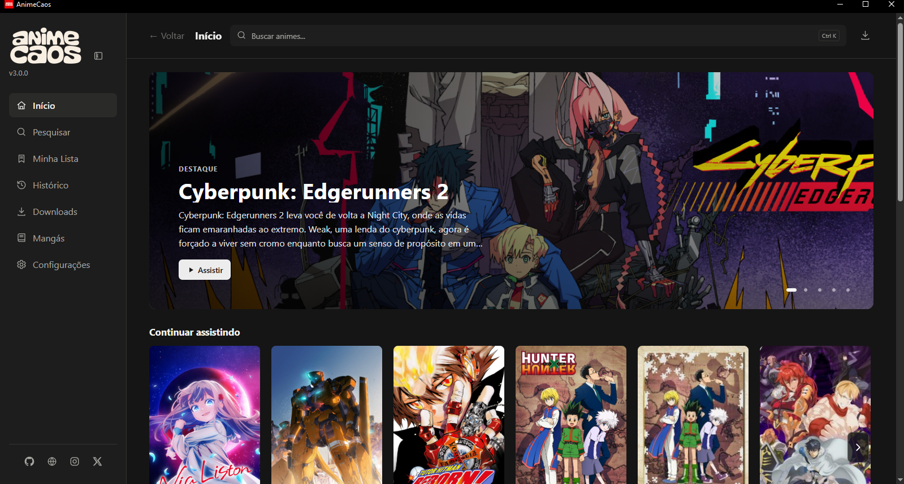</a><br><sub>Início · destaques e continuar assistindo</sub></td>
    <td align="center"><a href="assets/readme/search-results.png">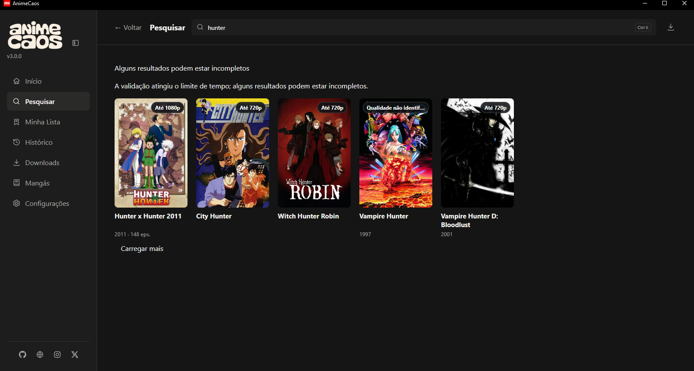</a><br><sub>Pesquisa · resultados agrupados por obra</sub></td>
  </tr>
  <tr>
    <td align="center"><a href="assets/readme/anime-details.png">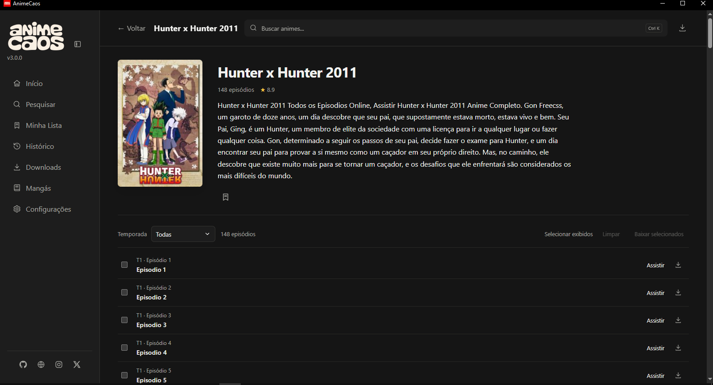</a><br><sub>Detalhes · temporadas e episódios</sub></td>
    <td align="center"><a href="assets/readme/my-list.png">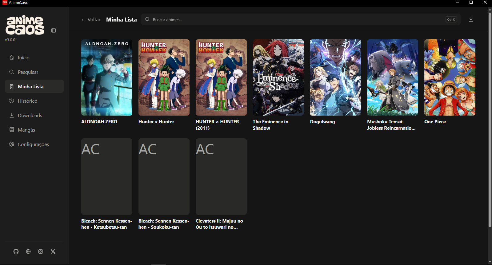</a><br><sub>Minha Lista · obras salvas para depois</sub></td>
  </tr>
  <tr>
    <td align="center"><a href="assets/readme/history.png">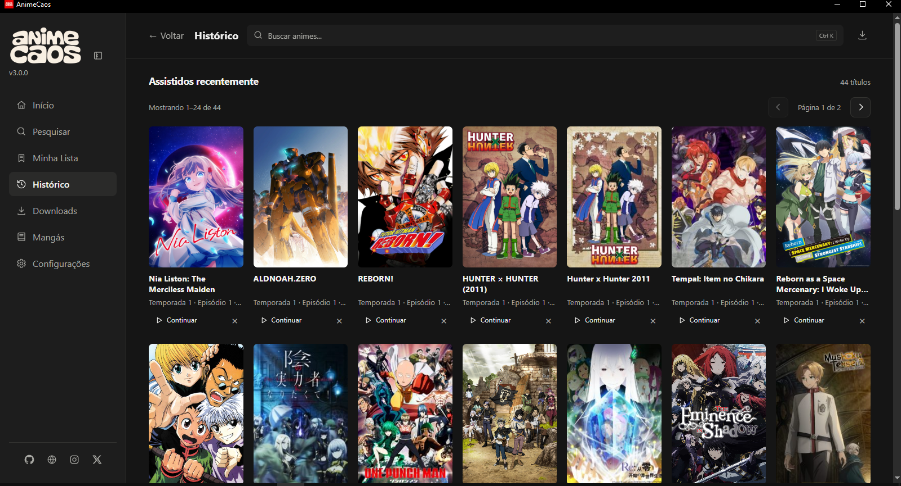</a><br><sub>Histórico · retome de onde parou</sub></td>
    <td align="center"><a href="assets/readme/downloads.png">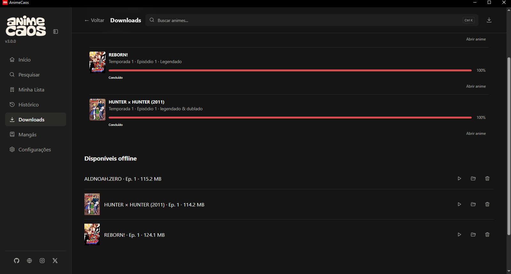</a><br><sub>Downloads · anime e arquivos locais</sub></td>
  </tr>
  <tr>
    <td align="center"><a href="assets/readme/manga-discovery.png">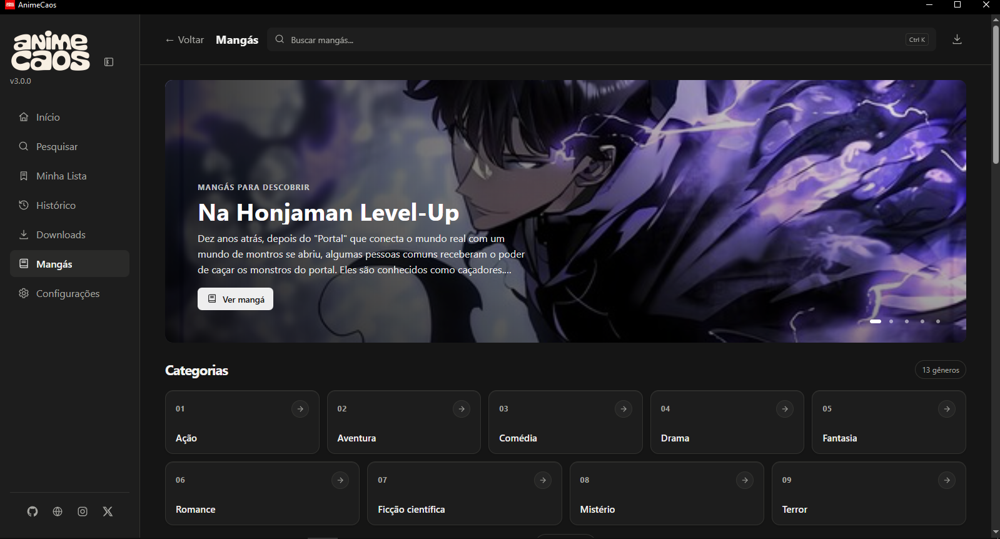</a><br><sub>Mangás · catálogo, gêneros e destaques</sub></td>
    <td align="center"><a href="assets/readme/manga-resume.png">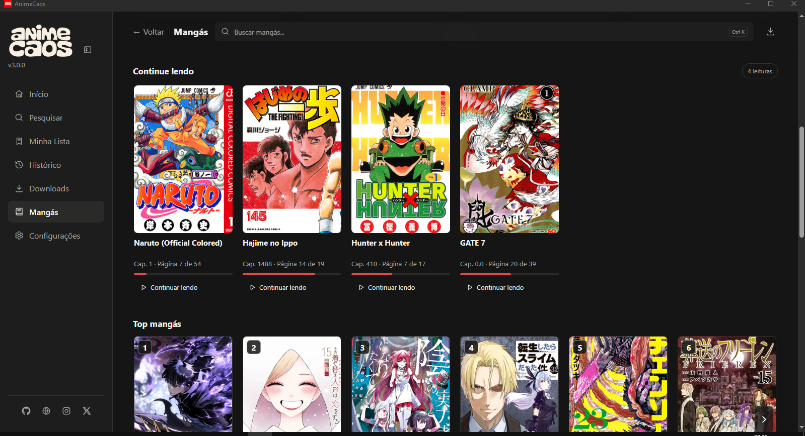</a><br><sub>Leitor · retome capítulos e páginas</sub></td>
  </tr>
</table>

## O que dá para fazer

| Área | Recursos |
|---|---|
| Anime | Descoberta, busca em múltiplas fontes, temporadas, episódios, player MPV, histórico e retomada |
| Biblioteca | Minha Lista, downloads e acesso a arquivos locais |
| Mangá | Catálogo MangaDex, filtros por gênero, capítulos, leitor contínuo ou paginado e downloads CBZ |
| Contas | Integração de progresso com AniList; conexão com MyAnimeList e Discord; presença no Discord opcional |
| Aplicativo | Temas claro/escuro/sistema, escala de interface, splash e atualização para builds instaladas |

Catálogos e streams dependem dos serviços externos e podem mudar ou ficar temporariamente indisponíveis.

## Baixar e instalar

A versão estável disponível é **v3.0.0**. Os pacotes ficam na [página da release](https://github.com/henriqqw/AnimeCaos/releases/tag/v3.0.0).

| Sistema | Pacote | Tamanho aproximado | Instalação |
|---|---|---:|---|
| Windows x64 | [Instalador](https://github.com/henriqqw/AnimeCaos/releases/download/v3.0.0/AnimeCaos-3.0.0-windows-setup.exe) | 490 MB | Baixe e execute o instalador. |
| Windows x64 | [ZIP portátil](https://github.com/henriqqw/AnimeCaos/releases/download/v3.0.0/AnimeCaos-3.0.0-windows-amd64.zip) | 670 MB | Extraia o ZIP e abra `AnimeCaos.exe`. |
| Linux x86_64 | [AppImage](https://github.com/henriqqw/AnimeCaos/releases/download/v3.0.0/AnimeCaos-3.0.0-x86_64.AppImage) | 343 MB | Torne executável e abra o arquivo. |

No Linux, pelo terminal:

```bash
chmod +x AnimeCaos-3.0.0-x86_64.AppImage
./AnimeCaos-3.0.0-x86_64.AppImage
```

### Requisitos

| Ambiente | Requisitos e limites conhecidos |
|---|---|
| Windows | Windows x64. WebView2, MPV, FFmpeg/FFprobe, Firefox e GeckoDriver vêm no pacote; não é necessário instalá-los separadamente. |
| Linux | AppImage x86_64. Ubuntu 24.04 LTS é o alvo validado; outras distribuições não têm compatibilidade confirmada. O sistema ainda precisa atender às dependências de kernel, gráficos e glibc do AppImage. |
| Rede | Internet para catálogo, metadados, streams, login externo e consulta de atualizações. Arquivos já baixados permanecem acessíveis localmente. |

O instalador e o executável Windows da v3.0.0 **não possuem assinatura Authenticode**; o Windows pode mostrar um aviso de editor desconhecido. A release publica `SHA256SUMS` com assinatura Sigstore para conferir a integridade dos arquivos. Essa assinatura não substitui Authenticode. Consulte [Distribuição](docs/DISTRIBUTION.md).

## Como usar

1. Na página **Início**, explore os destaques ou use a busca do cabeçalho. `Ctrl+K` leva o foco para a pesquisa.
2. Abra um resultado para ver temporadas e episódios e escolha **Assistir**. A reprodução usa o MPV incluído no pacote.
3. Salve uma obra em **Minha Lista** para encontrá-la depois. O **Histórico** permite retomar a reprodução.
4. Em **Downloads**, acompanhe arquivos de anime e abra itens já salvos. A pasta de destino pode ser alterada em Configurações.
5. Em **Mangás**, pesquise uma obra, selecione um capítulo e leia. O progresso de leitura é salvo; capítulos baixados ficam em arquivos CBZ.
6. Em **Configurações → Contas**, conecte os serviços disponíveis e escolha suas preferências de aparência, player e downloads.

## Opções do aplicativo

| Opção | Comportamento |
|---|---|
| Tema | Sistema, claro ou escuro |
| Escala da interface | Ajustável de 100% a 150% |
| Player | MPV incluído, player personalizado ou player padrão do sistema |
| Áudio | Preferência aplicada quando a fonte/player oferece essa opção |
| Reprodução | Autoplay do próximo episódio e fechamento automático da fila configuráveis |
| Downloads | Pasta de destino e concorrência de 1 a 5 downloads |
| Discord Rich Presence | Presença de reprodução opcional; requer o Discord Desktop aberto |
| Contas | Conectar, atualizar perfil ou desconectar AniList, MyAnimeList e Discord |

O progresso de anime é sincronizado com o AniList/MAL somente após o fim natural do episódio ou quando a posição alcança 80% da duração conhecida. A primeira conexão do MyAnimeList ainda não foi confirmada com uma conta real e pode falhar. A autorização e a presença do Discord também não foram validadas com uma conta/cliente real nesta rodada.

## Arquitetura

AnimeCaos é um aplicativo desktop. A interface React não chama um servidor REST próprio: o Wails conecta a UI ao serviço Go local.

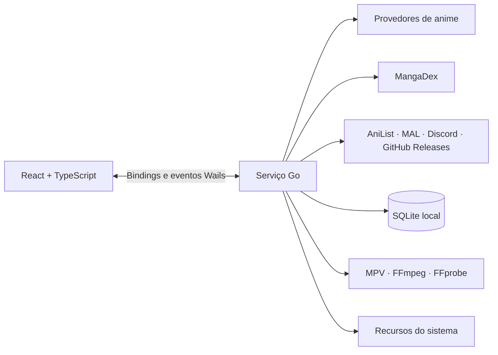

### Fluxos principais

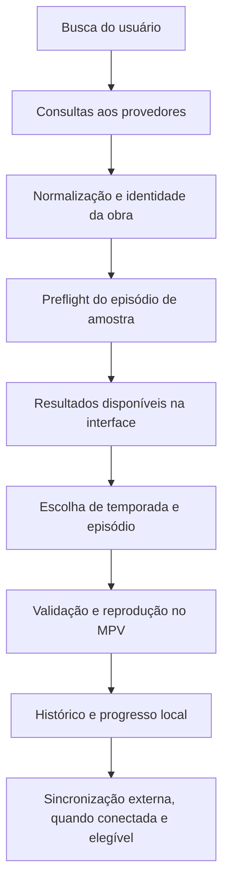

A busca consulta AnimeFire, AnimesOnlineCC, SushiAnimes e Otakulogia, normaliza os resultados e só exibe candidatos cujo episódio de amostra passou pelo preflight. O backend seleciona e valida a fonte de mídia; URLs temporárias de stream não são tratadas como dados duráveis.

## Stack

| Camada | Tecnologia | Responsabilidade |
|---|---|---|
| Desktop e integração nativa | Go 1.26, Wails 2.16 | Janela, bindings, eventos, arquivos e serviços da aplicação |
| Interface | React 19, TypeScript 5.8, Vite 6 | Telas, componentes e experiência responsiva |
| Dados locais | SQLite (`modernc.org/sqlite`) | Preferências, biblioteca, histórico, downloads e cache |
| Player e mídia | MPV, FFmpeg, FFprobe | Reprodução, leitura de mídia e validação de streams |
| Navegação de players | Firefox e GeckoDriver | Fallback para páginas de player que dependem de JavaScript |
| Testes | Go test, Vitest, Testing Library | Regras do backend, integrações simuladas e interface |

## API e integrações

### API da aplicação

O app **não expõe uma API HTTP/REST pública**. A UI usa métodos Go locais gerados pelo Wails, como `Search`, `Discover`, `Details`, `Play`, `Enqueue`, `MangaSearch`, `Chapters`, `Pages`, `Login` e `CheckUpdate`, além de eventos para progresso. A lista de métodos e DTOs está em [API da aplicação](docs/architecture/APP_API.md).

### Serviços externos

| Serviço | Uso |
|---|---|
| AnimeFire, AnimesOnlineCC, SushiAnimes, Otakulogia | Catálogo, temporadas, episódios e fontes de mídia |
| AniList | Descoberta, metadados e sincronização de progresso |
| MyAnimeList | Perfil e sincronização; primeira conexão real pendente de validação |
| MangaDex | Descoberta, busca, capas, capítulos e páginas de mangá |
| Discord | Perfil conectado e Rich Presence opcional |
| GitHub Releases | Consulta e entrega de atualizações das builds instaladas |

As integrações chamam os serviços diretamente pelo backend. Veja [Provedores e rede](docs/architecture/NETWORK_AND_PROVIDERS.md) e [Integrações](docs/architecture/INTEGRATIONS.md) para detalhes e limites.

## Dados e privacidade local

- Windows: `%APPDATA%/AnimeCaos`.
- Linux: `~/.local/state/AnimeCaos`.
- Preferências, biblioteca, histórico e progresso ficam em `state.db` (SQLite); downloads ficam na pasta configurada.
- Tokens OAuth novos ficam no cofre do sistema: Windows Credential Manager ou Linux Secret Service. Eles não são enviados aos bindings da interface.
- A migração pode importar arquivos locais de instalações Python antigas e preserva cópias em `legacy-backup/`.

## Atualizações

As builds instaladas do Windows e o AppImage consultam a release mais recente ao iniciar, baixam o pacote da plataforma e conferem seu SHA-256 antes de aplicar. `wails dev` e Flatpak não usam esse fluxo. A atualização entre `v3.0.0` e uma release futura ainda não foi observada ponta a ponta; os smoke tests da release exercitaram o mecanismo com os pacotes disponíveis naquele momento. Instalações Windows 2.0.0 podem pedir confirmação na primeira migração para 3.x; Flatpak antigo precisa migrar manualmente para AppImage.

## Perguntas frequentes

<details>
<summary>Preciso instalar Python, Go, Node ou um player?</summary>

Não para usar os pacotes de release. Os componentes de execução de mídia e WebView2 necessários estão incluídos nos pacotes de distribuição. Go, Node/npm e Wails são necessários apenas para desenvolvimento.
</details>

<details>
<summary>Por que o Windows pode mostrar um aviso de segurança?</summary>

Os binários Windows da v3.0.0 não têm assinatura Authenticode. Baixe pela release oficial e, se quiser verificar, confira o pacote contra `SHA256SUMS` e a assinatura Sigstore publicada junto dele.
</details>

<details>
<summary>O catálogo ou um episódio pode ficar indisponível?</summary>

Sim. AnimeCaos depende de serviços e páginas externas, que podem mudar, limitar acesso ou ficar fora do ar. A disponibilidade varia por obra, episódio e provedor.
</details>

<details>
<summary>O que funciona sem internet?</summary>

Você pode abrir e reproduzir arquivos já baixados e ler mangás CBZ locais. Busca, catálogo online, novos streams, login e atualização precisam de rede.
</details>

<details>
<summary>Onde ficam meus dados?</summary>

No diretório de dados do sistema indicado acima. O banco local e os downloads ficam separados dos arquivos do aplicativo.
</details>

<details>
<summary>O AnimeCaos tem uma API para outros aplicativos?</summary>

Não. Os bindings Wails conectam somente a interface do AnimeCaos aos serviços locais do processo.
</details>

## Desenvolvimento

### Pré-requisitos

- Go na versão indicada em `go.mod` (1.26.0 nesta release).
- Node.js e npm compatíveis com `frontend/package-lock.json`.
- Wails CLI v2 e dependências nativas de desenvolvimento: WebView2 no Windows; GTK/WebKitGTK no Linux.

### Rodar localmente com hot reload

```powershell
cd frontend
npm ci
cd ..
wails dev
```

Abra o AnimeCaos pela janela Wails. A URL do Vite, isolada no navegador, não possui os bindings `window.go` da aplicação.

Para comandos da CLI, testes e empacotamento, consulte [Desenvolvimento e operação](docs/OPERATIONS.md), [Testes](docs/TESTING.md) e [Distribuição](docs/DISTRIBUTION.md). Não é necessário compilar o app para instalar a release publicada.

## Documentação

| Documento | Conteúdo |
|---|---|
| [Visão geral da arquitetura](docs/architecture/OVERVIEW.md) | Camadas, entradas e responsabilidades |
| [Mapa do código](docs/CODE_MAP.md) | Localização dos arquivos e módulos |
| [Fluxos do produto](docs/PRODUCT_FLOWS.md) | Regras de busca, player, biblioteca e mangás |
| [Provedores e rede](docs/architecture/NETWORK_AND_PROVIDERS.md) | Fontes externas, scraping e limites conhecidos |
| [Integrações](docs/architecture/INTEGRATIONS.md) | OAuth, contas, MangaDex e atualizador |
| [Dados e migrações](docs/architecture/DATA_AND_MIGRATIONS.md) | SQLite, credenciais, arquivos e legado Python |
| [Testes](docs/TESTING.md) | Comandos e resultados registrados |
| [Distribuição](docs/DISTRIBUTION.md) | Pacotes, assinaturas e processo de release |
| [Changelog](CHANGELOG.md) | Alterações do projeto e histórico da versão |

<p align="center"><a href="https://www.animecaos.xyz/">🌐 animecaos.xyz</a> · <a href="https://github.com/henriqqw/AnimeCaos/releases">Todas as releases</a></p>
