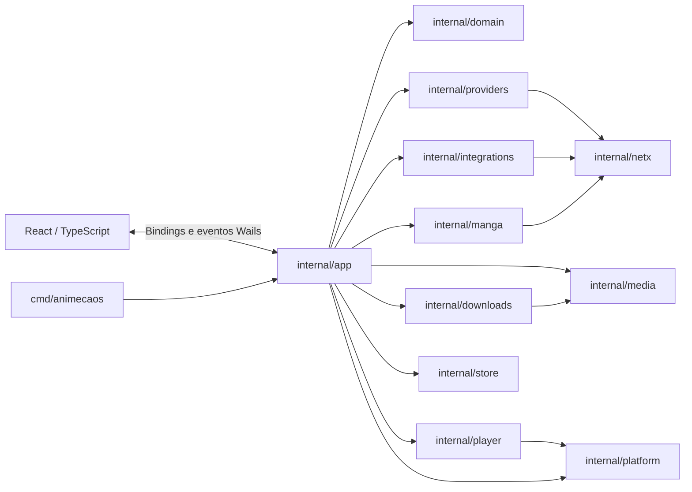

# Visão geral da arquitetura

**Estado:** implementação presente na árvore, conferida em 19/10/2026. O produto é um aplicativo desktop. A tela React não é um site autônomo: os métodos de aplicação são expostos pelo Wails e não existe servidor HTTP próprio para a interface.

## Stack observada

| Camada | Tecnologia | Uso no projeto |
|---|---|---|
| Desktop e bindings | Go 1.26, Wails 2.16 | Inicialização, janela, diálogos nativos, eventos e chamadas Go/JS |
| Interface | React 19, TypeScript 5.8, Vite 6 | Telas, componentes, estado da janela e estilos |
| Banco local | SQLite via `modernc.org/sqlite` | Preferências, biblioteca, histórico, fila, progresso, sessões e cache |
| Catálogo | AnimeFire API, AnimesOnlineCC HTML/Blogger, SushiAnimes HTML/AJAX, Otakulogia GraphQL | Pesquisa, temporadas, episódios e opções de mídia |
| Player e mídia | MPV, FFmpeg, FFprobe | Reprodução IPC, conversão/inspeção de mídia e HLS em operações de mídia |
| Testes UI | Vitest 5, Testing Library, jsdom | Comportamento de componentes e navegação |
| Testes Go | `go test` e `httptest` | Serviços, contratos de parser e integração controlada |

As versões estão em `go.mod` e `frontend/package.json`. O instalador e o ZIP portátil Windows incluem MPV/FFmpeg/FFprobe, Firefox/GeckoDriver e WebView2 Fixed Version; `internal/platform` aponta o Wails para o runtime junto ao app e prepara as permissões AppContainer do Windows. O AppImage inclui os binários de mídia, Firefox/GeckoDriver e bibliotecas GTK/WebKitGTK selecionadas. Requisitos inevitáveis do sistema operacional e ferramentas de desenvolvimento estão descritos em [operação](../OPERATIONS.md) e [distribuição](../DISTRIBUTION.md).

## Organização das camadas

`internal/app.Service` compõe os serviços e concentra as operações usadas pela interface e pela CLI. Os adaptadores externos ficam em pacotes próprios. `domain` contém os modelos compartilhados. A UI chama métodos exportados via bindings gerados pelo Wails; usa eventos separados para progresso e estado que mudam enquanto uma chamada está em andamento.

## Entradas do aplicativo

- `main.go`: inicializa o store, configura o serviço, incorpora `frontend/dist` no executável e cria a janela Wails. Valida a posição persistida antes de restaurá-la, traz a janela para frente com prioridade temporária na inicialização, reapresenta a splash quando uma segunda instância é aberta, integra abrir/ocultar/reiniciar/sair pela bandeja do Windows, espera o processo atual encerrar antes de relançar e roteia os helpers de reinicialização e atualização.
- `cmd/animecaos/main.go`: CLI para os mesmos serviços; não mantém uma segunda implementação do domínio.
- `cmd/package/main.go`: prepara um stage de distribuição, compila o frontend salvo que não seja passado `-skip-ui`, compila GUI e CLI, copia dependências e gera manifestos de hash.
- `deploy/go/`: script de AppImage, desktop entry e definição Inno Setup.

## Fronteiras e limitações atuais

- `frontend/src/App.tsx` ainda reúne muitas telas e comportamentos num arquivo único. O [mapa do código](../CODE_MAP.md) documenta o estado presente; separar componentes é trabalho futuro, não uma estrutura já existente.
- Os métodos Wails não são endpoints REST. Os endpoints HTTP documentados são integrações externas consumidas pelo backend.
- No Windows, fechar pelo botão X oculta a janela na bandeja; o menu do ícone permite abrir, minimizar, ocultar, reiniciar e sair. Na inicialização, a janela vai para frente e permanece acima das demais enquanto a splash está visível, com limite de segurança de 30 segundos; uma segunda abertura da mesma instância traz a janela para frente e recarrega a splash. Reiniciar aguarda a instância anterior fechar para preservar a exclusividade do mutex e mostrar a splash outra vez. Posições salvas só são reaplicadas quando a barra de título continua visível em algum monitor conectado.
- AnimeFire, AnimesOnlineCC, SushiAnimes e Otakulogia são os quatro provedores registrados em `Service.New`. AniList fornece metadados e descoberta, não é um provedor de streams. A disponibilidade dos sites muda; consulte [a validação por fonte](../TESTING.md#reprodução-real-das-fontes-restantes--18102026).
- A busca textual aproximada serve para classificação e filtragem de resultados fracos quando há metadados canônicos. A identidade é associada por aliases coincidentes e sem ambiguidade; semelhança, sozinha, não une animes.
- MelhorAnime não está registrado no catálogo Go. O código Python antigo permanece em `Legacy/` e não participa da execução Go.
- O estado real do site e de contas externas muda independentemente do código. Consulte os testes ao vivo opt-in e marque o resultado com data, em vez de tratar uma consulta antiga como garantia contínua.
